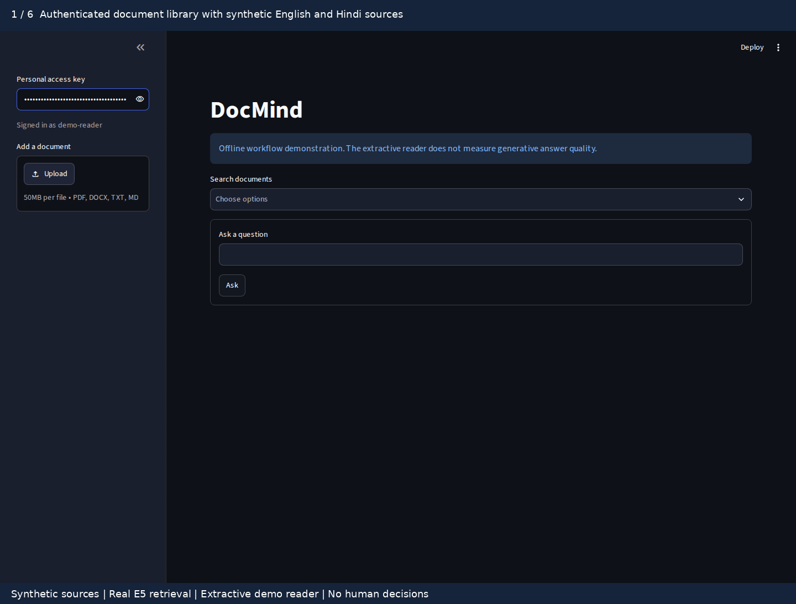

# DocMind

DocMind answers questions over PDF, DOCX and text documents using dense retrieval, a single reader call and quoted source passages. Drafts are explicitly unverified: deterministic quote matching locates evidence, while human review handles missing citations, incomplete-document abstentions and unmeasured languages. Published experiments include negative retrieval, attribution and calibration results; the quoted-draft path has a small frozen-evidence local-reader control, with only a small selected end-to-end study and a partial blinded second review.

The [current core evidence](docs/CORE_RESULTS.md) records completed results and remaining measurement limits. The [locked core-release plan](docs/CORE_RELEASE_PLAN.md) separates engineering checks from experimental and human evidence. The authenticated API and isolated parser are the deployment path; [centralized deployment](docs/DOCKER_CLOUD.md) documents setup. Native parsing and direct local UI require explicit trusted-development overrides. An opt-in [PostgreSQL profile](docs/POSTGRES_DEPLOYMENT.md) adds tenant isolation and persistent incremental vectors.

The default is pinned E5-small with dense retrieval. The Hindi comparison uses an English-only BGE model as a failure control; only one multilingual embedder was tested, within candidate pools containing gold passages. It does not establish a best multilingual retriever. Hindi Recall@5 was 75.9% versus 0.8% for English BGE in the declared MIRACL candidate pool. English was 74.1% versus 75.4%, with an uncertain difference. This is component evidence; Hindi answers still require review. Existing corpora need an [isolated migration](docs/API_MIGRATION.md#e5-dense-default).

See the [English/Hindi release evidence](docs/RELEASE_EVIDENCE.md) for fresh component intervals, the bounded T4 pilot, extraction failures and the single-reviewer label audit. Hindi PDF attribution and a balanced English/Hindi local-reader cohort remain unmeasured. The [fresh English protocol control](reports/releases/r4/paired_core_t4/README.md) completed 35 paired questions: candidate EM was 14.3% for single-call and 22.9% for ReAct, with an uncertain paired difference. Both used one call per question, so adaptive retrieval was not exercised.

The [latest quality follow-up](reports/releases/r5/README.md) reduced holds from 40 to 11 in a fixed 100-question English reference-input confirmation. In the selected own-document replay, the first reviewer judged 14/17 current answers correct and three drafts incorrect. These are routing and small-cohort diagnostics, not calibrated safety or independent reader accuracy.

The [second-review follow-up](reports/releases/r7/README.md) paired 16 answers and 33 claim units. Raw agreement was 87.5% and 90.9%, but kappa was only 0.55 and 0.47 with wide intervals. Two answer judgments and three claim judgments remain disputed; the initial labels have not been overwritten.

The [real-PDF support diagnostic](reports/releases/r8/README.md) found both judges accepted all 35 scored claims, matching an always-support baseline; one missing-evidence claim stayed unscored. The scored subset has no decisive second-review negative labels, so it cannot validate false-positive detection or justify a release gate.

The [public human-annotated support benchmark](reports/releases/r6/README.md) compares two NLI models on 600 calibration and 450 source-disjoint held-out responses. Neither met the frozen calibration requirements. Selected coverage is zero, with undefined risk; this mixed-task component does not establish PDF safety.

See the [bounded gap-closure evidence](docs/CLOSURE_EVIDENCE.md) for the new disjoint calibration study, broader attack suite and persistent-backend checks. The follow-up includes 27 human study labels with censored timings and a 50000-paragraph persistent-index profile.

[Explore recorded evidence](https://ananyat6979-commits.github.io/DocMind/) · [Hosting decision](docs/HOSTING_DECISION.md). The showcase replays real frozen outputs; it does not run inference or accept uploads.

[](https://github.com/ananyat6979-commits/DocMind/actions/workflows/ci.yml)
[](https://github.com/ananyat6979-commits/DocMind/actions/workflows/docker.yml)

Public image: `ghcr.io/ananyat6979-commits/docmind@sha256:d7ace7c78d27652b43f6fa251ead89f0556dd1f4794927e3c698e0b8f220fc9a`. [Inventory and signed provenance](reports/releases/r13/deployment/parser-quality-v4/image_publication.json) identify the tested build. The image includes cached model weights; the static showcase is the lightweight entry point.

## Workflow demo



Actual UI capture with synthetic documents, real E5 retrieval and an offline extractive reader. Added headings are presentation captions. [Plain screenshots and provenance](assets/demo/README.md) are separate; this demonstration does not measure generative answer quality.

## Measured results

Runs used available local compute and private free-tier T4 notebooks. No paid inference or compute was purchased. Intervals below are 95%; see the [technical write-up](docs/EVALUATION.md) for protocols, baselines, splits and limitations.

| Experiment | Held-out result | What it establishes |
|---|---|---|
| HotpotQA, dense BGE with headers, 200 questions | Recall@5 **94.25% [91.75, 96.50]** | Retrieval within the ten supplied distractor contexts |
| HotpotQA, hybrid plus reranker, same questions | Recall@5 **89.00% [85.75, 92.00]** | Reranking hurt support coverage in this setting |
| HotpotQA, 1.5B reader, dense top five | Exact match **20.0% [14.5, 25.5]** | High retrieval recall did not imply good answers |
| [SQuAD2, quantized CPU reader, 92 supplied passages](reports/releases/r11/final/README.md) | Exact match **23.9% [15.2, 32.6]** | Below 50.0% always-abstain baseline; zero of 46 unanswerable matched |
| [SQuAD2, quantized CPU prompt comparison, 24 paired questions](reports/releases/r13/final/README.md) | Exact match **29.2% to 50.0%** | Correct abstentions **0/12 to 4/12**. Revised EM tied always abstaining. |
| SQuAD2, 3B reader, 200 human-labeled questions | Exact match **57.5% [50.5, 64.5]** | Includes 100 answerable and 100 unanswerable items |
| SQuAD2, exploratory 7B reader, 200 fresh contexts | Exact match **66.5% [60.0, 73.0]** | Different held-out set; not a paired model comparison |
| CLIMATE-FEVER, selected span judge, 200 claims / 1,000 pairs | Attribution precision **72.7% [46.7, 100]**, recall **3.39% [1.28, 5.86]** | Human evidence labels, very low support recall |
| Selective prediction, both SQuAD2 studies | **0% automatic coverage** at calibrated 10%, 20% and 30% risk targets | No useful calibrated gate was demonstrated |
| Document injection, 50 cases per prompt | Attack success **12% [0, 32]** versus **30% [0, 60]** | Stronger prompt failed to improve this direct-reader test |

These are bounded experiments, not a full-wiki leaderboard or a safety certification. The opt-in backend has live tenant-isolation checks; actual deployment availability remains an operator responsibility. The completed human timing study does not demonstrate review-time savings. [Records and provenance](reports/benchmarks), [provider protocol comparison](reports/protocols/summary.json), [local service load](reports/service_load.json).

## Run locally

For a reproducible Windows CPU environment, use Python 3.11 and the hash lock below. Linux and Python 3.13 notebook targets have separate [locked environments](locks/README.md). From this checkout:

```powershell
py -3.11 -m venv .venv
.venv\Scripts\Activate.ps1
python -m pip install --require-hashes -r locks/cpu-windows-py311.txt --extra-index-url https://download.pytorch.org/whl/cpu
python -m pip install -e . --no-deps --no-build-isolation
Copy-Item .env.example .env
```

Use the [centralized deployment](docs/DOCKER_CLOUD.md) for individual credentials and the isolated parser. The following shared-key setup is development compatibility mode. Set the keys and passwords in `.env` privately. The UI requires `DOCMIND_APP_PASSWORD`; the API requires `DOCMIND_API_KEY`; review operations require `DOCMIND_REVIEWER_PIN`; document deletion and rebuild in the UI require `DOCMIND_ADMIN_PIN`. Missing credentials disable the corresponding access. Select a currently available hosted model with `python scripts/list_models.py`, then set `DOCMIND_LLM_MODEL`. `DOCMIND_SECRETS_FILE` can point to a private dotenv file outside the checkout. Never put secrets in a notebook or archive.

Run the API and UI in separate terminals. PDF/DOCX ingestion requires the parser service; native parsing is an explicit trusted-input override documented in the deployment guide.

```powershell
python scripts/cache_models.py
streamlit run app.py
python -m docmind.api.server --host 127.0.0.1 --port 8000
python scripts/verify_benchmark_reports.py
```

For development checks, install `pytest pyyaml httpx ruff mypy` in the locked environment and run `python -m pytest -q`. The test suite uses hash embeddings and a demo reader without downloading models. `DOCMIND_TEST_MODE=1` uses explicit development backends and must stay off in a deployed service. Run `cache_models.py` once with network access to cache the pinned retrieval and attribution models. Optional NLI diagnostics read cached weights and cannot grant or deny draft release. Docker bakes those weights into the image; see [deployment](docs/DOCKER_CLOUD.md).

## How it works

Uploads are validated and parsed through a separate confined service. Explicit native development mode uses a resource-limited subprocess. PDF pages, DOCX tables and text become chunks with stable document identity, source metadata and ingestion lineage. The local SQLite profile stores the corpus and embeddings atomically and builds only the dense or sparse views needed by the selected mode. The opt-in PostgreSQL profile updates a persistent pgvector HNSW index in the same transaction as document metadata; its scoped dense queries use exact filtered search. RRF fusion and an optional cross-encoder rank candidates.

The default reader returns structured claims linked to exact chunk IDs and verbatim quotes. Unique literal or NFC/whitespace-normalized matches carry offsets into the retrieved chunk, not invented PDF page coordinates. Matching quotes establish location, not entailment. NLI is an optional diagnostic, off by default; it never gates the new release policy. `DOCMIND_ANSWER_STRATEGY=react` enables the bounded frozen-evidence cost-benefit control. Historical ReAct/native experiments retain their original implementations and results.

`DOCMIND_RELEASE_MODE=draft` shows eligible drafts and evidence with an explicit unverified label. `strict` requires human approval. Invalid quotes/citations, quarantined cited pages, incomplete-document abstentions and unvalidated languages remain held. Complete-document abstentions are visible with a warning that retrieval may have missed information. Clean-page answers name missing pages when the selected source is partial. Stored historical decisions keep their original policy identity.

The UI and API support approve, correct and reject decisions. Review exports remain separate from the frozen public test set. Structured request logs carry request IDs and timings; `/health` is public liveness, while `/ready`, `/metrics`, queries and the library require authentication. Personal credentials establish audit identity and operation roles. The PostgreSQL profile additionally isolates tenant libraries; readers within a tenant share that library. Final responses retain individual ownership checks.

## Reproduce the evidence

```powershell
python scripts/materialize_public_corpus.py
python scripts/verify_benchmark_reports.py
python scripts/public_benchmark.py --device cuda --batch-size 32 --allow-download
python scripts/attribution_benchmark.py --device cuda
python scripts/qa_and_robustness.py --device cuda
python scripts/selective_benchmark.py --device cuda
python scripts/judge_comparison.py --device cuda
python scripts/critic_benchmark.py
```

The last three commands require GPU libraries beyond the lightweight test dependencies. See [free-compute instructions](docs/CLOUD.md) before running them. The public corpus downloader verifies source hashes and all 200 original human annotations. Experiments publish explicit source snapshots because some runs preceded later correctness fixes. Rerunning writes new outputs; keep the published artifacts unchanged or regenerate their manifest deliberately.

For your own documents, draft labels with `scripts/make_testset.py`, verify them with `scripts/verify_testset.py`, then use `scripts/evaluate.py`. Reference scoring is local by default. Failed questions remain in the denominator. Optional legacy judge integration is outside the supported dependency set.

## Limits and security

English and Hindi retrieval components are measured; Hindi automatic answers and further languages remain gated. The default English attribution judge has poor measured recall, and scanned PDFs need OCR. Hosted inference sends retrieved text to Groq. Prompt injection remains possible, including one contaminated candidate in the broader current-serialization test. SQLite still rebuilds derived caches and supports one service process. Use the separate PostgreSQL profile for persistent indexing, tenant policies, shared quotas and leased workers. Small fixture tests and synthetic throughput do not establish production availability or hosted inference latency. Historical synthetic ANN failures and newer real-embedding profiles remain separately documented.

Read [security and retention](SECURITY.md), [evaluation and failure analysis](docs/EVALUATION.md), and [public data attribution](data/public/README.md).

## License

Application code: MIT. Public benchmark data has separate upstream terms, described in the data card.
