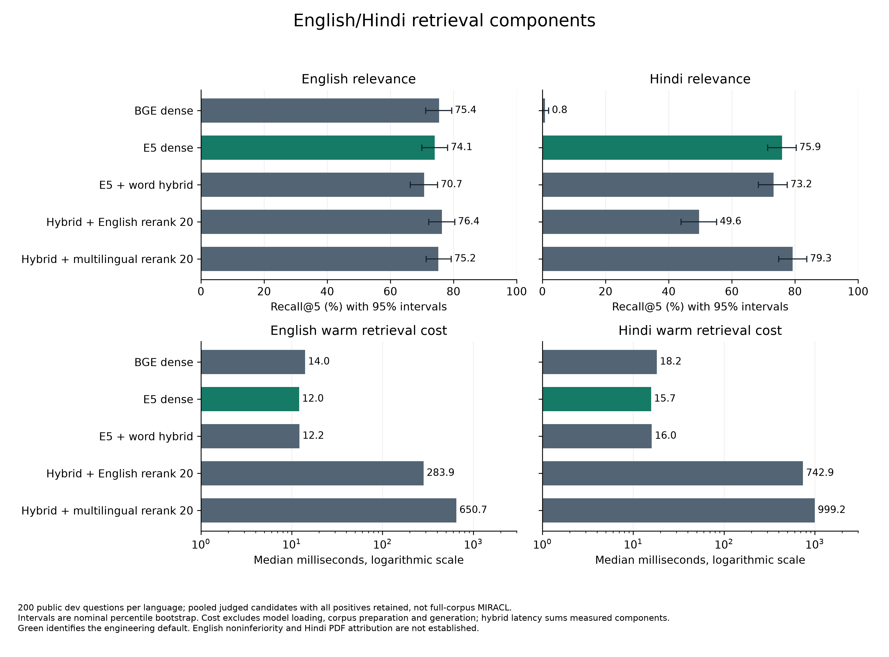

# English and Hindi release evidence

This release separates corrected service behavior, component measurements and deployment isolation. The measured evidence does not establish a validated English/Hindi PDF answering release. Hindi and other unvalidated languages continue to require review. French remains unmeasured.

## Protocol and provenance

Historical benchmark files remain unchanged. New runs use Transformers 5.23.0, Sentence Transformers 5.7.0, tokenizers 0.23.3 and pinned model revisions. CPU and CUDA environments have hash locks. Source snapshots, corpus hashes, offsets and model-consumed metadata identify cached inputs. Numeric summaries are under [reports/releases/r1](../reports/releases/r1). Restricted PDF text, XNLI examples, human annotation records and private review notes stay outside Git.

XNLI is a component test, not PDF attribution. Each language uses 200 seed-seven test examples with original public labels. The selected multilingual model trained on XNLI development data, which is excluded here. Entailment uses a fixed 0.8 threshold. Intervals use 2,000 premise-cluster bootstrap resamples. A zero-error precision result with one positive decision per independent cluster uses an exact binomial boundary interval; the degenerate bootstrap interval is retained alongside it. This reporting correction was made after the first run without changing predictions or thresholds.

The first CPU and T4 measurements below used Torch 2.11.0. A subsequent dependency check identified the [`torch.jit.script` advisory](https://github.com/advisories/GHSA-rrmf-rvhw-rf47) and [legacy wheel-installation issue](https://github.com/advisories/GHSA-xmj3-9gf7-h52w). Deployment locks now target Torch 2.13.0 and setuptools 84.2.1. The application does not directly call `torch.jit.script`; fixed dependencies still require fresh compatibility and component checks. Original results retain their recorded versions and are not relabeled as results for the updated stack. Private dependency audit reports are not committed. A PyPI audit cannot directly identify the local-version CPU/CUDA wheels, so the matching base Torch version is checked separately; that does not certify every binary artifact.

The fresh [Torch 2.13 CPU baseline](../reports/releases/r1/cpu-ci-torch213) passed independent verification. Its 800 NLI scores and E5 vector hash matched the earlier CI run exactly, and HNSW recall remained 99.1% [98.5, 99.6]. Updated CPU deployment compatibility and Python CI passed. The older FP16 T4 reader profile still describes its original CUDA dependencies; it is not evidence for the updated CUDA stack.

An additional updated-CUDA attempt stopped during environment setup. Its corrected retry was removed while queued after the chosen retrieval profile changed and CPU comparisons completed. Updated CUDA reader results remain unmeasured. The setup failure archive and source snapshot are retained privately.

## NLI results

| Judge and language | Precision, 95% interval | Recall, 95% interval |
|---|---:|---:|
| English judge, English | 97.9% [92.9, 100] | 71.2% [60.3, 82.0] |
| Multilingual judge, English | 100% [89.1, 100] | 48.5% [36.1, 60.9] |
| English judge, Hindi | 50.0% [35.9, 65.0] | 33.3% [22.4, 44.8] |
| Multilingual judge, Hindi | 88.6% [77.4, 97.4] | 47.0% [34.8, 59.3] |

Local CPU, free CI CPU and T4 runs produced the same aggregate decisions. The [CI records](../reports/releases/r1/cpu-ci) retain 800 numeric NLI predictions and 400 ANN rankings without source text or gold labels. Recompute their counts and intervals with `python scripts/verify_component_records.py reports/releases/r1/cpu-ci --xnli-cache <private-cache>`. The cache holds `xnli-en.parquet` and `xnli-hi.parquet` downloaded from the pinned revision. This checks scoring and cohort accounting without rerunning inference. The multilingual judge improves this Hindi component result but reduces English recall. Neither result validates real Hindi PDF claim support, claim extraction recall or false-release risk. A blanket judge replacement would conceal the English regression.

## Bounded local-reader T4 pilot

The pinned Qwen3-4B-Instruct-2507 reader ran in FP16 with temperature zero, seed seven and SDPA on a Tesla T4. Three English template drafts over a real licensed PDF completed. There were six reader calls, zero recorded numerical failures and zero token-cap truncations. Each question used two calls. Input tokens grew from 348-362 to 2,083-2,718; generated output totaled 156, 335 and 203 tokens per question. Question times were 20.23, 34.51 and 21.16 seconds. These three questions cannot establish Hindi speed or final cohort size.

The component and reader profile took 177.84 seconds; setup-inclusive measured session time was 268.37 seconds with two GPUs allocated. The watchdog limit was 6,900 seconds. Measured elapsed allocation and conservative reservation are separate accounting quantities. The process-wide peak CUDA allocation was 11.38 GB, including component work; this is not an isolated reader memory measurement. No paid compute or new hosted evaluation requests were used.

One pilot answer had citation-existence validity 1.0 and judged claim support 0.0. The other two had both scores 1.0. Thus a perfect citation score did not establish judged support. These [numeric diagnostics](../reports/releases/r1/t4_citation_diagnostics.json) have no human correctness labels.

Frozen answer/evidence replay held claims and the judge fixed. Legacy versus repaired evidence segmentation produced supported fractions 0 to 0, 1 to 1 and 0 to 1. These are support judgments, not human correctness labels. All three answers required review because the source document contained quarantined pages. That 100% routing rate includes the partial-document policy and cannot be attributed to the judge alone. A clean-PDF default withholding rate remains unmeasured. This pilot used BGE with hybrid English reranking and recursive chunks, not the subsequently chosen E5 dense default. The hosted default also remains unmeasured.

No balanced English/Hindi PDF cohort was frozen: a usable Hindi task pool and separate fresh-condition timing were not established. The remaining compute ceiling is not a reason to invent a cohort or label drafts human gold.

## Extraction diagnostics and human review

Seven deliberately selected Hindi PDFs contained 46 pages: 23 suspected legacy-font pages, 17 uncertain/mixed, four image-only/empty and two automatically usable. The two passing pages were short pages from the legacy-font document and yielded two unreviewed template drafts. They do not establish a usable Hindi PDF evaluation cohort. The English PDF had 92 pages, 89 usable and three suspected. These heuristics do not certify readability; blank pages are not distinguished reliably from scans. This is a diagnostic sample, not a representative language estimate. OCR and font conversion remain outside scope.

One reviewer completed the blinded 15-pair Hindi public-label packet in 520 active seconds: 11 decisive labels, four unclear items and four disagreements with original labels among decisive items. The 36.4% decisive-subset disagreement rate is not a population label-error estimate. Original public benchmark labels remain unchanged. Optional delayed consistency is unmeasured. No inter-annotator agreement is claimed. The PDF review budget remains unused, and Hindi PDF answer correctness and claim-support labels remain unmeasured. False-release risk therefore has insufficient evidence.

## ANN and retrieval scope

Real multilingual E5 embeddings replaced the historical Gaussian-vector stress input for a new application-path test. HNSW Recall@10 against exact search was 99.1% [98.5, 99.6] over 100 queries and 3,340 vectors. CPU unscoped median search time was 0.140 ms versus exact 0.273 ms, excluding embedding. Scoped requests deliberately use an exact filtered scan, with linear cost. This small sentence corpus establishes fidelity on this input, not production scale, semantic relevance or an incremental persistent index. The old 50,000-vector experiment remains unchanged and is not directly comparable.

The MIRACL workflow freezes 200 original public dev queries per language, retains all positive passages, up to ten judged negatives per query and deterministic distractors. Its lexical, embedding, reranker and candidate-depth comparisons are a judged-candidate component experiment, not official full-corpus MIRACL. Restricted source text stays private. Every condition reports requested-cohort and completed-only statistics; unserved rows retain zero scores in the requested denominator. Paired differences use matched completed query IDs and must not be generalized from incomplete profiles. The lexical measurements below completed locally. Neural embedding and reranker comparisons completed and passed independent artifact validation.

### Neural retrieval and the default decision

Both CPU profiles completed all 21 conditions: 200 questions per condition and 4,200 ranking rows per run, with zero failed or unserved rows. [Torch 2.11 records](../reports/releases/r1/miracl-torch211) remain separate from the [Torch 2.13 baseline](../reports/releases/r1/miracl-torch213). Every per-query quality metric matched across the upgrade; two rankings changed order without changing their metrics. Runner hardware and floating-point ties prevent attributing every ordering change solely to the library version. The lexical and neural corpus/cohort semantic hashes match.

| Configuration | English Recall@5, 95% interval | Hindi Recall@5, 95% interval | Warm median ms, English / Hindi |
|---|---:|---:|---:|
| English BGE dense | 75.42% [71.19, 79.42] | 0.80% [0.07, 2.00] | 14.02 / 18.22 |
| Multilingual E5 dense | 74.10% [70.01, 78.15] | 75.93% [71.36, 80.38] | 12.05 / 15.73 |
| E5 word hybrid | 70.70% [66.34, 74.96] | 73.20% [68.44, 77.56] | 12.15 / 16.02 |
| E5 hybrid + English reranker, depth 20 | 76.38% [72.18, 80.41] | 49.63% [43.90, 55.18] | 283.88 / 742.91 |
| E5 hybrid + multilingual reranker, depth 20 | 75.24% [71.39, 79.25] | 79.29% [74.83, 83.77] | 650.69 / 999.20 |

The [default-selection analysis](../reports/releases/r1/default_selection.json) is an exploratory engineering decision over predeclared component conditions. E5 versus BGE changes English Recall@5 by -1.32 points [-4.70, 1.88], so English noninferiority is not established. Hindi gains 75.13 points [70.52, 79.74]. E5 dense is the balanced-language, lower-cost default; the result does not establish better general PDF answers. Hindi answer release remains gated.

Fusion reduced English recall by 3.40 points [-6.64, -0.20] relative to E5 dense. Multilingual reranking improved recall against that fused baseline, but its gain against E5 dense was uncertain: English +1.14 [-2.66, 4.65] and Hindi +3.36 [-1.08, 7.56] points. Its median cost was roughly 54 to 64 times dense retrieval on this run. Candidate depth five only permutes five items and therefore cannot improve Recall@5; nDCG and MRR can still change. Depth twenty can recover lower-ranked evidence.

The English reranker reduced Hindi Recall@5 to 49.63%, while the multilingual reranker at the same depth reached 79.29%. Model/language fit matters. Grapheme trigrams also failed to establish a hybrid recall gain: -0.12 points [-3.68, 3.40] versus ordinary word fusion. They stay optional. Full nDCG, MRR, paired differences and latency records are published rather than selecting one favorable metric.

The service now defaults to pinned E5 dense retrieval and leaves reranking explicit. The English NLI judge remains in place because replacing it globally reduced English component recall. Old embeddings and reranker thresholds require the [documented isolated migration](API_MIGRATION.md#e5-dense-default). These component measurements do not validate the hosted generator or automatic Hindi PDF attribution. Full retrieval runs are deliberate `workflow_dispatch` experiments; automatic CI keeps unit, type, real-model compatibility and bounded NLI/ANN checks.

### Measured lexical ablation

The [lexical records](../reports/releases/r1/miracl-lexical) contain 1,000 verified rankings: 200 questions per language, 4,024 English passages and 3,964 Hindi passages. NumPy 2.4.6 and regex 2026.11.9 match the locked environments. No neural model was loaded. Gold passages are deliberately retained in each candidate pool; these results are not full-corpus MIRACL.

| Language and representation | Recall@5, 95% interval |
|---|---:|
| English, legacy regex | 59.46% [54.64, 64.18] |
| English, repaired word tokens | 59.39% [54.57, 63.96] |
| Hindi, legacy regex | 43.40% [37.58, 48.98] |
| Hindi, repaired word tokens | 60.61% [54.97, 65.77] |
| Hindi, words plus grapheme trigrams | 62.64% [57.06, 68.17] |

The paired Hindi word-token gain is **17.21 percentage points [10.59, 23.90]**. The English change is -0.07 points [-1.57, 1.43]. Legacy Hindi fragments retained some retrieval signal; the evidence shows an improvement, not zero baseline capability.

Trigrams add 2.03 points [-2.00, 6.22] over repaired Hindi words, so the extra quality gain is not established. Hindi vocabulary grows from 34,313 to 74,277 terms, index construction takes 3.44 versus 44.37 seconds, and median query time grows from 0.675 to 10.104 ms on the same Windows host. Single-run timing is descriptive, not a production SLA. Trigrams remain optional because their measured cost is substantial and their extra recall interval includes zero. No Hindi stemming or stopword change was introduced.

Recompute all row scores, intervals and paired differences without neural inference using `python scripts/verify_miracl_records.py reports/releases/r1/miracl-lexical`. This downloads the pinned public topics and qrels, without source passage text. Original public judgments are not independently reviewed; the Hindi XNLI audit is a separate task.

Ablation intervals are nominal 95% exploratory intervals, without a family-wise multiple-comparison guarantee. Historical injection tests do not validate the new local reader against prompt injection.

## Service and deployment checks

Behavioral regressions cover Unicode boundaries, numeric fragments, citation ambiguity, review leakage and edits, authentication before quota allocation, bounded key/IP buckets, reference-aware orphan cleanup and environment allowlisting. The isolated parser uses a bounded Unix socket, no network access or secret mounts, a read-only filesystem, an unprivileged identity and resource controls. CI exercises denial, exhaustion and recovery. The same real benchmark PDF matched native and container text, page identities, offsets and model-consumed metadata, including the cached Windows extraction identity. This supports transport-only reuse for that tested input, not universal parser equivalence.

The centralized UI delegates library and review access to the authenticated API. Individual credentials supply trusted audit identities. SQLite, in-process quotas and the job queue still require one API service process. Tenant isolation, distributed enforcement, incremental persistent indexing, representative API load and measured review time savings remain limitations. Container confinement is not a claim of protection against every kernel vulnerability.

A bounded [native Windows check](../reports/releases/r1/windows_model_smoke.json) used the fixed CPU lock, cached real E5/NLI models and offline demo generation. Model-path assertions completed in 161.6 seconds on a synthetic eight-claim fixture; the parent process hit its 180-second cap after output was written. This is a partial compatibility observation, not a passing process-lifecycle or latency test. Startup, inference and shutdown costs were not isolated. Native Windows performance remains a measured limitation; the full offline Linux container check passed. No provider calls or model downloads were made by the native check.

## Licensing

XNLI upstream noncommercial terms apply independently of model licenses. mMARCO declares Apache-2.0 while upstream MS MARCO specifies noncommercial research use; this is not commercial clearance. MIRACL dataset metadata and underlying Wikipedia attribution/share-alike obligations both matter. Per-PDF licenses, hashes and source URLs appear in extraction diagnostics. Publication here uses aggregate results and provenance, without restricted text or annotation records.

See [release gates](RELEASES.md), [model card](MODEL_CARD.md), [threat model](THREAT_MODEL.md) and [centralized deployment](DOCKER_CLOUD.md). Remaining unmeasured gates are explicit release limits, not passing results.

## Follow-up extraction and service diagnostics

Five deliberately selected source-versus-extraction pages received one-reader labels: three readable but damaged and two unusable. These are extraction-quality judgments, not question validity, answer correctness or claim-support labels. No population error rate or "85 percent accurate" estimate follows from this sample. The browser-visible timer recorded 699.5 seconds and may include idle time; it is conservatively charged to the existing PDF review pilot and buffer. Raw pages, text, notes and labels remain private. See the [aggregate](../reports/releases/r2/hindi_pdf_quality_review.json).

A repeated long-digit artifact that previously passed extraction checks is now quarantined by quality policy v2. Isolated numeric fragments and tables of distinct long identifiers remain accepted. Existing production answers from stale or missing quality-policy lineage require review. Fresh native Windows parser identity is recorded separately; historical parser identities and neural results remain unchanged and do not validate the changed metadata.

The [second Windows diagnostic](../reports/releases/r2/windows_startup_diagnostic.json) timed out after 240 seconds, before ingestion completed. Torch import alone consumed 67.3 seconds, and stack captures showed subsequent dependency imports. No shutdown stage was reached. This identifies an initialization bottleneck in that run, without explaining the earlier 180-second timeout or proving a deadlock.

The [Windows loopback HTTP observation](../reports/releases/r2/http_windows_standins.json) completed 40/40 warm requests at concurrency four, with zero HTTP failures or unserved rows. Completed-only p50/p95 were 141.0/187.0 ms. API readiness took 9.33 seconds, queued ingestion 1.59 seconds and the separate cold query 0.98 seconds. This used hash embeddings and demo generation, a quota override and a tiny repeated synthetic fixture. It measures socket HTTP plumbing, not neural or hosted-reader performance. Warm percentiles exclude startup, ingestion and the cold query; harness termination does not establish graceful shutdown. Source hash, dependency identities and numeric rows accompany the report. The [Linux Docker HTTP profile](../reports/releases/r2/http_linux_real_models/summary.json) used real E5 embeddings and the configured NLI path with demo generation, completing 12/12 warm requests at concurrency two. Completed-only p50/p95 were 696.6/816.5 ms; queued ingestion took 7.30 seconds and the separate cold query 0.47 seconds. All request IDs were present. This first harness checked HTTP success and configuration, not stored NLI-completion counts; that additional verification is a separate follow-up. Twelve repetitions of one question are not twelve independent QA examples. `/ready` establishes configuration/store readiness, not that every neural model has been warmed.

An [identical staged Windows repeat](../reports/releases/r2/windows_startup_repeat.json) completed model assertions and exited with status zero in 82.0 seconds under the same 240-second cap. Torch import took 10.6 seconds, ingestion completed at 68.1 seconds, query completion at 71.8 seconds and the exit handler at 72.3 seconds. The failed initialization run remains published. These observations show variable initialization and a successful process exit, not a proven shutdown fix or isolated host-performance cause.

The [stored-NLI-verified HTTP follow-up](../reports/releases/r2/http_linux_verified_nli/summary.json) completed 12/12 warm requests, plus the separate cold query, and verified thirteen stored judgments with the pinned English NLI identity and finite support fractions. Warm p50/p95 were 521.9/572.6 ms at concurrency two. This is a separate CI run, not an established speedup over the earlier observation. It retains the same tiny-fixture, demo-generation and single-process limits. Successful NLI execution does not validate the judgments or answer correctness.

Fresh local-reader profiles now record failed calls, including prefill-budget errors and numerical failures. Generated-token counts remain unknown when generation fails without returning tokens. Submitted input tokens and elapsed failure time are retained, preventing successful-call-only budget accounting. The reader identity records `attempts-v2`; historical results are unchanged. Updated CUDA inference remains unmeasured.
