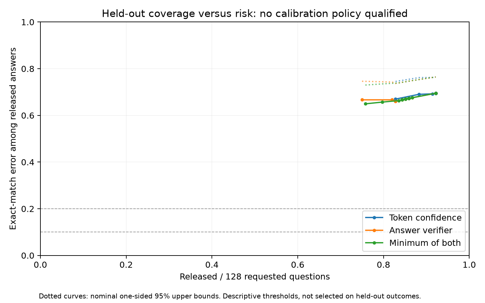

# Document-disjoint calibration component

The frozen local-reader study completed 128 calibration and 128 held-out HotpotQA questions after ten timing-only questions. The capped timing pilot selected the cohort size before evaluation outcomes. All 256 frozen requests completed, with no generation or verification exceptions. No policy on the predeclared threshold grid passed the corrected exact-match risk bound at either 10 or 20 percent target error. This is a negative result, not a certificate of safe abstention.

| Held-out feature | AUROC | Nominal bootstrap 95% interval | Available scores |
|---|---:|---:|---:|
| Generated-token confidence | 0.757 | [0.655, 0.851] | 125 |
| Separate answer-verification prompt | 0.562 | [0.495, 0.623] | 118 |
| Minimum of both | 0.756 | [0.658, 0.850] | 118 |

Ungated exact match was 36/128, or 28.1 percent. Model abstention and truncated outputs remain in the requested denominator. Ranking availability differs by signal, so the table does not establish a paired improvement. Exact-match risk can penalize aliases and wording; it does not measure factual error or human claim support. These results use supplied HotpotQA distractor articles, E5 paragraph retrieval, and a direct local Qwen reader. They are not an estimate for real PDFs, Hindi, the production ReAct flow or the hosted provider.

The fixed-grid verifier threshold of 1.0 still selected 96 held-out answers, with 64 exact-match errors. Its saturated probability is not evidence of correctness. Token confidence ranked answers more usefully but did not isolate a low-risk release set on the frozen grid. A different grid, new features or larger calibration sample requires a new study rather than tuning these outcomes.



Curves are descriptive held-out diagnostics. Dotted curves are nominal one-sided upper bounds. Thresholds were selected exclusively on calibration data with a family correction across 126 fixed comparisons and a minimum of 30 selected calibration answers. Every qualifying-policy comparison routes all 128 held-out items to review. The legacy numeric key `reviewed` in the frozen execution summary means **review required**, not completed human annotation. Actual human timing and correctness review are separate and pending. No assumed seconds per review are presented as measured.

Reproduce numeric checks without neural inference:

```sh
python scripts/verify_calibration_closure.py reports/releases/r3/calibration
python scripts/plot_calibration_closure.py reports/releases/r3/calibration
```

`executed_source.json` identifies every executed public source file from commit `3519c1d9ce16efea830114a3c017e75ce892b52b`. The private result archive was checked against all 59 file hashes before publication. Original source paragraphs, reference answers, the blinded review packet and raw review exports stay outside Git. Public question IDs, generated short answers, machine-computed benchmark labels, protocol metadata and aggregate statistics support traceability. The elapsed free T4 session was 981.46 seconds including setup; both allocated devices remain covered by the private compute ledger. There were no hosted-provider calls.

Source: [HotpotQA dataset](https://huggingface.co/datasets/hotpotqa/hotpot_qa), pinned dataset revision `1908d6afbbead072334abe2965f91bd2709910ab`, validation parquet SHA-256 `c20b638ca82b21d04fe12e14ff417ad05153d4d215a65de54497fca4e972f7c6`. The dataset declares CC BY-SA 4.0. Credit HotpotQA authors and underlying Wikipedia contributors; source redistribution and attribution obligations still apply. Public answer labels were not independently human-reviewed for this study. Historical results are unchanged.
