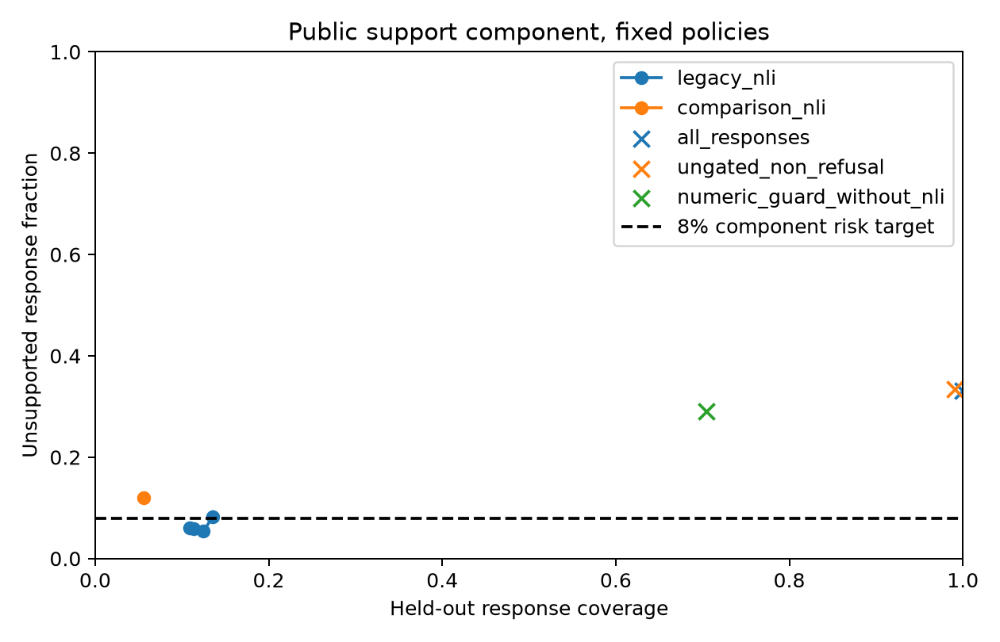

# Public response-support benchmark: no qualifying policy

The frozen comparison completed on free public CPU runners. Neither pooled nor task-stratified calibration selected a policy. Selected held-out coverage is **0/450** and unsupported-answer risk is **undefined**, with insufficient evidence. This does not establish useful safe coverage or validate the PDF product's release behavior.

## Design and execution

The [protocol](PROTOCOL.md) and [design](support_risk_design.json) were committed before inference. RAGTruth supplies original human span annotations. We deterministically selected one recorded response per source: 600 calibration responses from the official training split and 450 held-out responses from the official test split. The tasks are QA, Summary and Data2txt, with 200 calibration and 150 held-out sources each. Source IDs and context hashes are disjoint. This is 450 mixed-task responses, including 150 QA responses, not 450 new PDF questions or independent human review of the current reader.

The models are pinned DistilBERT MNLI and the small DeBERTa NLI cross-encoder; exact repository revisions and package identities are retained with the results. Forty fixed policies compare these models, two evidence depths, numeric checks on/off and five thresholds. Selection uses calibration only. The primary task-stratified criterion and the pooled sensitivity both fail; neither is replaced after inspecting test outcomes. The requested target is at most 5% observed unsupported responses and an exact upper bound at most 8%, with multiplicity correction and minimum sample requirements. No policy was selected from the displayed test curves.

Both models retained all 1,050 requested rows. Each completed NLI scoring on 895 responses; 155 exceeded the fixed twelve-span limit and remained withheld in the denominator. On held-out responses, each completed 390 and withheld 60 for that limit. There were no budget-unserved cases, runtime failures or invalid annotation-offset round trips. Setup-inclusive scoring took 954.08 seconds for the legacy model and 1,595.30 seconds for the comparison, within their separate 1,800-second ceilings. Dependency-installation time is outside those scoring timers. There were no GPU seconds, new reader calls, hosted calls or paid annotation.

[Completed workflow](https://github.com/ananyat6979-commits/DocMind/actions/runs/43832881455), [execution identity](component/execution.json), [numeric rows](component/numeric_records.json), [summary](component/summary.json), [calibration choices](component/calibration_selection.json) and [artifact hashes](component/publication_manifest.json) are available. Raw source text, complete responses and original span annotation files remain outside Git.

## Held-out baselines and fixed-policy diagnostics

The numeric-guard baseline also enforces the fixed span/input limits and excludes text-detected refusals; its difference from all responses is not an isolated numeric-check effect. It checks numbers against full context, rather than the product's quoted-citation contract. The all-response baseline includes three human quality-problem cases; the non-refusal baseline includes none. Quality failures remain separate from unsupported-span labels.

These are support filters on identical recorded answers. They are not generation, retrieval-quality or framework baselines. Unsupported means at least one original annotated span, including factual-but-unsupported content. It is not a complete correctness or usefulness label.

| Condition | Released / 450 | Coverage | Unsupported among released | Nominal one-sided 95% upper risk |
|---|---:|---:|---:|---:|
| All recorded responses | 450 | 100.0% | 149/450, 33.1% | 36.9% |
| Text-detected non-refusals | 446 | 99.1% | 149/446, 33.4% | 37.3% |
| Numeric guard without NLI | 317 | 70.4% | 92/317, 29.0% | 33.5% |
| Legacy NLI, depth 4, threshold 0.5, no numeric guard | 61 | 13.6% | 5/61, 8.2% | 16.5% |
| Comparison NLI, depth 4, threshold 0.5, no numeric guard | 25 | 5.6% | 3/25, 12.0% | 28.2% |
| Legacy NLI, depth 4, threshold 0.9, numeric guard | 49 | 10.9% | 2/49, 4.1% | 12.3% |
| Selected primary policy: none | 0 | 0.0% | Undefined | Insufficient evidence |

The fixed-policy rows are descriptive points from the predeclared grid, not promoted alternatives. Their bounds are nominal, without simultaneous test-curve correction. The final row is the actual calibration result. A low observed error fraction does not establish a low upper bound. Below 25 releases, risk and precision remain unestimated under the reporting rule; zero observed errors at a stricter threshold is not a safety result.

At threshold 0.5 and depth four without numeric checks, legacy support-release precision/recall is 91.8%/18.6%, versus 88.0%/7.3% for the comparison. Recall uses the 301 held-out responses with no annotated unsupported span. These are response-support metrics, not claim-extraction recall, answer usefulness or current-PDF attribution accuracy. Threshold values are not calibrated equally across models, so these points do not establish universal model superiority.

The plot shows nominal point fractions for fixed policies with enough released cases. It does not show confidence bands; consult the table and full [fixed-policy records](component/fixed_policy_curves.json) for upper bounds. No curve is a certified production operating region.

## Failure analysis and limits

- The failure is not explained solely by multiplicity correction. In a post-hoc sensitivity over the same calibration grid, no policy with at least 25 releases meets even the uncorrected 8% upper bound. The smallest nominal upper bound is 28.1%, with 15 unsupported of 78 released calibration responses. This sensitivity does not replace the frozen selection.
- Task differences matter. Calibration unsupported counts are 68/200 QA, 64/200 Summary and 136/200 Data2txt; held-out counts are 24/150, 31/150 and 94/150. At threshold 0.5/depth four without the numeric guard, the legacy model releases 32 QA, 27 Summary and only two Data2txt responses; both Data2txt releases are unsupported. The comparison releases 21 QA, four Summary and no Data2txt responses. Aggregate coverage hides those differences. Observed split differences also weaken matched-distribution assumptions.
- The twelve-span ceiling is part of the method and withholds 60/450 test responses. The result includes this length filter, lexical window selection and sentence segmentation, not an isolated test of NLI weights. Of 22,768 evaluated evidence pairs per model, 1,224 legacy and 1,187 comparison pairs exceeded the combined token budget before premise clipping. Missing support can lower recall. This run does not identify the independent causal contribution of each limitation.
- Numeric filtering retains substantial unsupported content. Exact quotes, source availability and entailment do not establish question relevance, authority, complete factual correctness or document completeness.
- Original public labels are used without a new independent label audit. Model training cards do not prove absence of all pretraining overlap. No second reviewer, inter-annotator agreement, Hindi PDF labels or claim-extraction gold is supplied by this component.

The product keeps NLI diagnostic-only. The separate current PDF replay remains 14 correct and three incorrect answers in a selected 17-answer single-reviewer cohort, with all three incorrect answers visible as unverified drafts. This component does not repair those reader errors or provide calibrated PDF release risk.

## Rights and reproduction

Source: [RAGTruth paper](https://aclanthology.org/2024.acl-long.585/), [pinned data repository](https://github.com/ParticleMedia/RAGTruth/tree/c103204b9ce28d6bbad859304bf30de72b8ed8fe). The [upstream MIT notice](RAGTRUTH_LICENSE.txt) is retained. Original QA sources derive from [MS MARCO](https://microsoft.github.io/msmarco/) with noncommercial research terms; other original source rights are not cleared by a dataset or model license. No commercial clearance or source-text redistribution is claimed.

Run `python scripts/verify_support_risk.py reports/releases/r6/component` for model-free identity, denominator, selection, curve and artifact checks. Floating calculations allow a 1e-12 tolerance for cross-platform math-library rounding; integer counts, IDs and hashes remain exact. These checks establish internal numerical consistency, not external replication or semantic validity. The locked CPU scoring and plotting environments and manual workflows reproduce the frozen method; reruns must use new output directories and remain separate from this snapshot.
